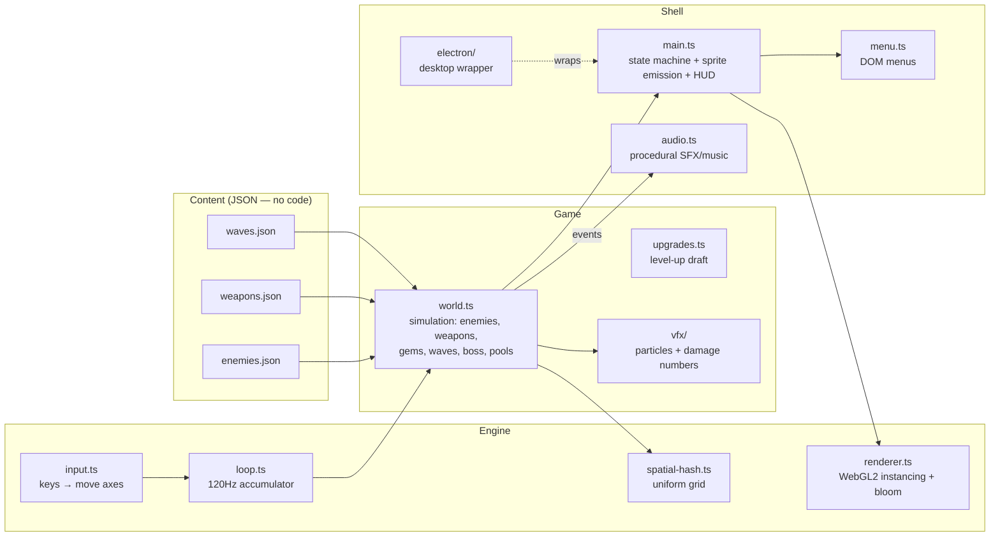
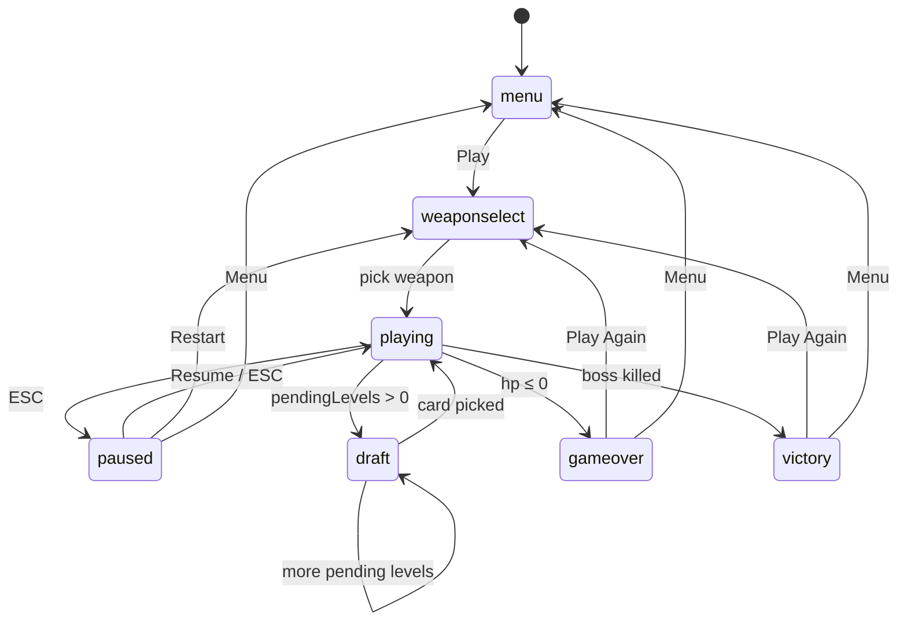
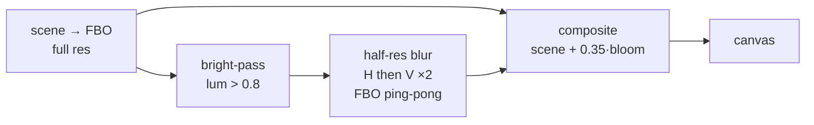

# Learning Guide — Swarm Survivors

A guided tour of the codebase: what it is, how it fits together, and where to look when you want to change something. Read top to bottom, or jump to the section you need.

## The end goal

Build a **Vampire Survivors-style arena roguelike** that doubles as a **computer graphics showcase**. Two goals in one project:

1. **A playable game** — survive 10 minutes against escalating waves, level up, draft upgrades, kill the boss. Ships to itch.io (browser) and desktop (Windows/macOS/Linux).
2. **A CG techniques demo** — every sprite in one GPU draw call, spatial-hashed collision, object pooling, bloom post-processing — with a benchmark proving each optimization matters (`docs/benchmark.md`).

The design constraint that shapes everything: **zero runtime dependencies**. No engine, no framework — TypeScript talking straight to WebGL2.

## Tech stack

| Layer      | Tech                                                                          | Where                                              |
| ---------- | ----------------------------------------------------------------------------- | -------------------------------------------------- |
| Language   | TypeScript (strict)                                                           | `src/`                                             |
| Rendering  | Raw WebGL2 — instanced sprites + FBO post-processing                          | `src/engine/renderer.ts`                           |
| Simulation | Fixed 120Hz timestep, custom spatial hash                                     | `src/engine/loop.ts`, `src/engine/spatial-hash.ts` |
| Audio      | Procedural Web Audio API — synthesized SFX + generative music, no audio files | `src/audio/audio.ts`                               |
| UI         | Plain DOM overlays (no UI framework)                                          | `index.html`, `src/ui/menu.ts`                     |
| Content    | Pure JSON data files                                                          | `src/data/*.json`                                  |
| Art        | AI-generated PNGs → runtime texture atlas; procedural shapes as fallback      | `public/sprites/`                                  |
| Build      | Vite                                                                          | `vite.config.ts`                                   |
| Desktop    | Electron + electron-builder                                                   | `electron/`, `electron-builder.yml`                |
| Testing    | Playwright (smoke test, screenshots, benchmark, balance bot)                  | `scripts/`                                         |
| Quality    | ESLint + Prettier + Husky/lint-staged hooks                                   | root config files                                  |
| Deploy     | Butler CLI → itch.io                                                          | `scripts/publish-itch-web.sh`                      |

## The big picture



Three clean layers:

- **`src/engine/`** knows about GPUs, clocks, and grids — nothing about vampires.
- **`src/game/`** knows about enemies, weapons, and XP — nothing about WebGL.
- **`src/main.ts`** is the only file that knows both sides; it reads world state and tells the renderer what to draw.

## Anatomy of one frame

The game renders once per `requestAnimationFrame`, but _simulates_ at a fixed 120Hz — several (or zero) sim ticks per rendered frame.

```mermaid
sequenceDiagram
    participant RAF as requestAnimationFrame
    participant Loop as loop.ts
    participant World as world.ts
    participant Main as main.ts
    participant GL as renderer.ts

    RAF->>Loop: frame(now)
    Note over Loop: accumulator += elapsed (clamped 250ms)
    loop while acc ≥ 1/120s
        Loop->>World: update(dt, moveX, moveY)
        Note over World: spawns → move enemies → rebuild hash<br/>→ player contact → separation<br/>→ weapons → projectiles → gems → VFX → reap dead
    end
    Loop->>Main: render()
    Main->>GL: begin(camX, camY)
    Note over Main: push() one SpriteInstance per entity:<br/>grid, arena, player, gems, enemies,<br/>orbits, projectiles, particles, damage digits
    Main->>GL: flush()
    Note over GL: ONE drawArraysInstanced call<br/>uploads instance buffer + draws all sprites
    Main->>GL: endFrame()
    Note over GL: bright-pass → blur ×4 → composite<br/>(bloom post-processing via FBOs)
```

Why fixed timestep? Physics and gameplay behave identically on a 60Hz laptop and a 240Hz monitor — render rate is decoupled from game logic.

## Game state machine

`main.ts` owns a small state machine; `menu.ts` renders the DOM overlay for each state.



## File-by-file guide

### Engine (`src/engine/`)

| File                                          | What it does                                                                                                   | Key ideas                                                                                                                                                                                                                                                                                      |
| --------------------------------------------- | -------------------------------------------------------------------------------------------------------------- | ---------------------------------------------------------------------------------------------------------------------------------------------------------------------------------------------------------------------------------------------------------------------------------------------- |
| [renderer.ts](src/engine/renderer.ts)         | The GPU workhorse. `push()` queues a sprite, `flush()` draws **all** of them in one `drawArraysInstanced` call | Instance buffer = flat `Float32Array` (14 floats/sprite: pos, size, color, UV, flash, rotation). Doubles capacity when full. `endFrame()` runs the bloom pipeline (bright-pass → separable blur ping-pong at half-res → additive composite). `naive` mode does per-sprite draws for benchmarks |
| [loop.ts](src/engine/loop.ts)                 | Fixed-timestep game loop                                                                                       | Accumulator pattern: sim always steps in 1/120s increments; a 250ms cap prevents the "spiral of death". Reports update/render timings per frame                                                                                                                                                |
| [spatial-hash.ts](src/engine/spatial-hash.ts) | Uniform-grid neighbor index                                                                                    | Entities bucketed by `floor(x / 96)`; `queryCircle` only checks the cells a circle overlaps → near-O(1) lookups instead of O(n²). Buckets are reused (length=0), not reallocated                                                                                                               |
| [input.ts](src/engine/input.ts)               | WASD/arrow keys → normalized move axes                                                                         | A `Set` of held keys; `moveX`/`moveY` getters compute -1/0/+1                                                                                                                                                                                                                                  |

### Game (`src/game/`)

| File                                                    | What it does                    | Key ideas                                                                                                                                                                                                                                                              |
| ------------------------------------------------------- | ------------------------------- | ---------------------------------------------------------------------------------------------------------------------------------------------------------------------------------------------------------------------------------------------------------------------- |
| [world.ts](src/game/world.ts)                           | The entire simulation           | Owns all entity arrays (enemies, projectiles, gems, dying corpses), object pools, wave spawning, boss trigger, weapon ticks, XP/leveling, hit-stop/shake. One `update()` call = one 120Hz tick. Emits string events (`"kill"`, `"gem"`…) that `main.ts` maps to sounds |
| [weapons.ts](src/game/weapons.ts)                       | Weapon instances + stat merging | Level N stats = level-1 base + each level's delta merged on top. Data lives in `weapons.json`                                                                                                                                                                          |
| [upgrades.ts](src/game/upgrades.ts)                     | The 3-card level-up draft       | Builds a pool (weapon upgrades + new weapons + stat boosts), picks 3 without replacement, applies the choice                                                                                                                                                           |
| [types.ts](src/game/types.ts)                           | Shared shapes                   | `EnemyDef`, `WeaponDef`, `Wave` — the TypeScript contracts matching the JSON files                                                                                                                                                                                     |
| [vfx/particles.ts](src/game/vfx/particles.ts)           | Pooled particle bursts          | Hit sparks, death bursts, level-up flash. Capped at 2048                                                                                                                                                                                                               |
| [vfx/damage-numbers.ts](src/game/vfx/damage-numbers.ts) | Pooled floating damage numbers  | Rise and fade; rendered as atlas digit sprites. Capped at 128                                                                                                                                                                                                          |

### Content (`src/data/`)

Pure JSON — edit these to change the game without touching code.

| File                                  | Contents                                                                                                                                     |
| ------------------------------------- | -------------------------------------------------------------------------------------------------------------------------------------------- |
| [enemies.json](src/data/enemies.json) | 16 defs: `hp, speed, size, color, xp, damage, boss?`                                                                                         |
| [weapons.json](src/data/weapons.json) | 10 weapons × 8 levels. `type` picks the mechanic (`projectile`/`aura`/`orbit`/`nova`); level 1 is the full stat block, levels 2–8 are deltas |
| [waves.json](src/data/waves.json)     | Spawn timeline: `{time, spawnInterval, enemies[], boss?}` — 12 escalating phases over 10 min                                                 |

### Shell

| File                                         | What it does                                                                                                                                                                                                                                                         |
| -------------------------------------------- | -------------------------------------------------------------------------------------------------------------------------------------------------------------------------------------------------------------------------------------------------------------------- |
| [main.ts](src/main.ts)                       | Entry point: state machine, world↔renderer bridge, camera shake, HUD/perf overlay, test hooks (`window.__perf`, `window.__state`). Rendering is split into small named helpers: `drawPlayer`, `drawGems`, `drawEnemies`, `drawWeaponSprites`, `drawVfx`, `updateHud` |
| [menu.ts](src/ui/menu.ts)                    | All DOM screens: main menu, weapon select, pause, settings, draft cards, game over/victory stats                                                                                                                                                                     |
| [audio.ts](src/audio/audio.ts)               | `AudioEngine`: every sound is an oscillator/filtered-noise recipe; music is a generative 16-step loop. Volume persisted to localStorage                                                                                                                              |
| [desktop.d.ts](src/desktop.d.ts)             | Type declarations for the Electron bridge and test hooks                                                                                                                                                                                                             |
| [index.html](index.html)                     | Canvas + HUD divs + all menu CSS (the whole UI stylesheet lives here)                                                                                                                                                                                                |
| [electron/main.cjs](electron/main.cjs)       | Desktop main process: window, GPU switches, validated IPC (fullscreen, window size, quit, real CPU/RAM metrics)                                                                                                                                                      |
| [electron/preload.cjs](electron/preload.cjs) | `contextBridge` exposing a minimal, validated `desktopRuntime` API                                                                                                                                                                                                   |

## The CG techniques (the "showcase" part)

### 1. Instanced rendering — one draw call for everything

```
CPU side, per frame:
  enemies/projectiles/particles/... → SpriteInstance{pos,size,color,uv,flash,rot}
                                   → packed into ONE Float32Array
                                   → gl.bufferSubData (single upload)
                                   → gl.drawArraysInstanced(TRIANGLE_STRIP, 0, 4, N)
GPU side:
  vertex shader reads per-instance attribs (divisor=1),
  builds each quad from 4 corners → N sprites, 1 draw call
```

Compare: the naive path does N uploads + N draws. At 10k sprites that's the difference between ~2 FPS and playable (`docs/benchmark.md`).

### 2. Texture atlas — one texture for all art

```
┌───────────────── atlas 4096×2048 ─────────────────┐
│ procedural block (512×512)  │ AI sprite tiles     │
│  square circle ring diamond  │ 256×256 each        │
│  spark  digits 0-9           │ enemies, player,    │
│                              │ gems, projectiles   │
└──────────────────────────────┴─────────────────────┘
```

Each instance carries a UV rect, so a single bound texture serves every sprite — zero texture swaps per frame. PNGs under `public/sprites/` are drawn into the atlas at load; if a file is missing the game silently falls back to the procedural shapes.

### 3. Spatial hashing — O(1) neighbor lookups

```
world → 96px grid cells → Map<cellKey, Entity[]>

queryCircle(x, y, r): only the cells the circle overlaps
  instead of checking all N entities → ~all-local candidates
```

Used for enemy separation, player contact, aura/orbit/projectile hits. This is what keeps the sim viable past ~2k enemies (O(n²) separation alone is 261ms at 2k — see benchmark).

### 4. Object pooling — near-zero GC churn

Enemies, projectiles, gems, particles, and damage numbers are never freed mid-run — dead objects go back onto a freelist and get re-initialized on the next spawn. Dead-array removal uses the swap-pop trick (`a[i] = a[last]; a.pop()`).

### 5. Bloom post-processing



Separable Gaussian blur (5 taps per pass) at half resolution — classic cheap bloom.

### 6. Procedural audio

No audio files: SFX are one-shot oscillator sweeps (`tone()`) and filtered noise bursts (`noise()`); music is a `setInterval` step-sequencer layering kick, bass line, and random arpeggio notes. A per-name throttle map prevents sound stacking.

## Common tasks

### Add an enemy

1. Append a def to `src/data/enemies.json` (`id`, `hp`, `speed`, `size`, `color`, `xp`, `damage`; add `"boss": true` for a boss).
2. Add it to a wave's `enemies` list in `waves.json`.
3. Optional art: drop `<id>.png` (and `<id>-walk2.png` for a 2-frame walk cycle) into `public/sprites/` — it's picked up automatically; without it you get the colored fallback shape.

### Add a weapon

1. Append a def to `src/data/weapons.json` with a `type` of `projectile`, `aura`, `orbit`, or `nova` and a `levels` array (level 1 = all stats; later levels = only changed stats).
2. Optional: `public/sprites/proj-<id>.png` for projectile art.
3. It automatically appears in the weapon-select screen and level-up drafts.

### Change difficulty / pacing

- `waves.json` — spawn intervals and enemy mix per phase.
- `src/game/world.ts` `TEST_LEVEL` — arena size, player HP/speed, enemy cap, pickup radius.
- XP curve: `xpNext = 6 + (level - 1) * 5` in `gainXp`.

### Debug / experiment hooks (URL params)

| Param          | Effect                                            |
| -------------- | ------------------------------------------------- |
| `?naive`       | Naive renderer + O(n²) collision (benchmark mode) |
| `?stress=5000` | God mode + N enemies spawned (benchmark mode)     |
| `?speed=4`     | Run sim 4× fast (balance testing)                 |

## Scripts worth knowing

| Command                           | Purpose                                                                |
| --------------------------------- | ---------------------------------------------------------------------- |
| `npm run dev`                     | Vite dev server — fastest iteration                                    |
| `npm run test:smoke`              | Headless Playwright plays ~2 min, picks drafts, asserts the loop works |
| `npm run benchmark`               | naive-vs-optimized stress test → `docs/benchmark.md`                   |
| `npm run bot`                     | Kiting AI plays automated balance runs                                 |
| `npm run screenshots`             | Regenerates README screenshots (runs pre-commit)                       |
| `npm run desktop:dev`             | Electron + hot reload                                                  |
| `npm run package:{win,mac,linux}` | Desktop installers via electron-builder                                |
| `npm run deploy:itch:web`         | Butler push to itch.io (also runs post-commit)                         |

## Repo layout

```
swarm-survivors/
├── index.html          # canvas + HUD + all menu CSS
├── LEARNING.md         # ← you are here
├── FILE-TREE.md        # one-line-per-file reference
├── README.md           # pitch, features, commands
├── TODO.md             # milestone checklist (all done)
├── src/
│   ├── main.ts         # glue: states, sprite emission, HUD
│   ├── engine/         # renderer, loop, spatial hash, input
│   ├── game/           # world sim, weapons, upgrades, vfx
│   ├── data/           # enemies/weapons/waves JSON
│   ├── ui/             # DOM menus
│   └── audio/          # procedural WebAudio
├── electron/           # desktop wrapper (main + preload)
├── scripts/            # smoke test, benchmark, bot, screenshots, deploy
├── docs/               # benchmark report, grading writeup, sprites brief
└── public/sprites/     # AI-generated PNGs loaded into the atlas
```

## Suggested reading order

1. `src/engine/loop.ts` (34 lines) — the heartbeat.
2. `src/game/types.ts` + `src/data/*.json` — the vocabulary.
3. `src/game/world.ts` — the simulation, top to bottom.
4. `src/engine/renderer.ts` — where CPU-side sprites become GPU work.
5. `src/main.ts` — how it all gets glued into a frame.
